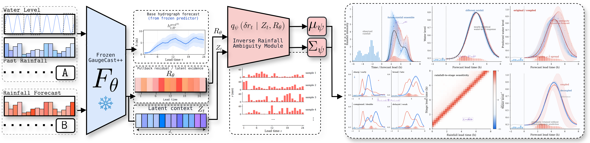
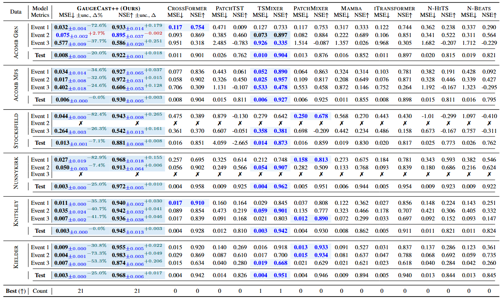
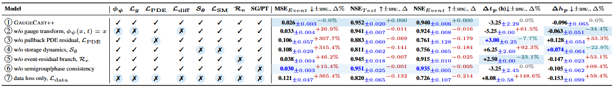

# GaugeCast++: A Physics-Informed Latent Forecasting System for Localized Flood Prediction

[]()
[]()
[](LICENSE)

**GaugeCast++: A Physics-Informed Latent Forecasting System for Localized Flood Prediction**  
Adrian Kucia, Edward Rollason, Wai Lok Woo  
**NeurIPS 2026**

GaugeCast++ is a physics-informed sparse-gauge forecasting framework for localized flood prediction. It combines a gauge-conditioned pullback operator, semigroup-consistent phase-transport learning, and decoupled inverse rainfall ambiguity modelling.


> **Paper status:** NeurIPS 2026 paper link and publication details will be added when available.

## News

- **2026-11-15:** Initial public repository scaffold and project README created.

## Method Overview

GaugeCast++ is designed around the failure modes that are especially important in sparse-gauge flood forecasting: transport-dominated dynamics, temporal misalignment of flood events, and uncertainty in future rainfall forcing. The framework combines physics-informed latent dynamics with event-aware forecasting and a separate post-hoc uncertainty diagnostic.

### Gauge-Conditioned Pullback Dynamics

<p align="center">
  
</p>

GaugeCast++ does not evolve flood dynamics directly in the original observation coordinates. Historical water level, rainfall, and forecast rainfall are encoded into latent hydrological states and storage/context representations. A **gauge-conditioned coordinate map** $G_\psi$ then learns a sample-dependent transformation of the latent domain.

Training suppresses $B_\psi$, encouraging the learned coordinate system to remove explicit transport from the latent evolution. The resulting pullback therefore acts as an **operator preconditioner**, transforming transport-dominated flood dynamics into a better-conditioned latent forecasting problem.

---

### Decoupled Inverse Rainfall Ambiguity

<p align="center">
  
</p>

Forecast errors can arise either from the hydrological model itself or from inaccurate future rainfall information. GaugeCast++ separates these two sources through a **decoupled inverse rainfall ambiguity module**.

The trained GaugeCast++ predictor is first frozen. Its hydrograph forecast, latent representation, and physics residual are then used as evidence for an inverse model
which estimates a posterior distribution over the unknown rainfall discrepancy. The inferred uncertainty is propagated through the rainfall-to-stage sensitivity of the frozen predictor to obtain a forcing-specific ambiguity score.

Importantly, this module is **diagnostic rather than corrective**: it does not modify the deterministic GaugeCast++ hydrograph. Instead, it identifies forecast windows in which uncertainty can plausibly be attributed to imperfect future rainfall forcing.

## Main Results

GaugeCast++ achieves the strongest overall performance across the six primary UK catchments, with consistent gains in both full test-set forecasting and flood-event prediction.

<p align="center">
  
</p>

## Ablation Study

The ablation study evaluates the contribution of the gauge transform, pullback PDE residual, storage dynamics, event-residual branch, and semigroup/phase-consistency objectives.

<p align="center">
  
</p>

## Installation

Create an environment and install the dependencies:

```bash
conda env create -f environment.yml
conda activate gaugecast
```

Or install with pip:

```bash
python -m pip install -r requirements.txt
```

## Data

Place input datasets in `data/`. The repository does not currently include datasets; see [`data/README.md`](data/README.md) for notes. Data files are excluded from version control by `.gitignore`.

## Quick Start

The repository currently contains a project scaffold. Training, evaluation, and prediction entry points are placeholders and will raise `NotImplementedError` until their workflows are implemented. The example below shows the intended interface, not a runnable command yet:

```bash
python train.py --config configs/acomb_garden_house.yaml
```

## Training

Training functionality is not implemented yet. The `train.py` entry point and `scripts/train_all.sh` are placeholders. Site-specific configuration files are in `configs/`.

## Evaluation

Evaluation functionality is not implemented yet. The `evaluate.py` entry point is a placeholder.

## Reproducing Paper Results

The scripts in `scripts/` are scaffold placeholders. Commands to reproduce the paper's tables, ablations, and uncertainty analysis will be added with the training and evaluation implementation:

- `scripts/reproduce_table1.sh`
- `scripts/reproduce_table3.sh`
- `scripts/reproduce_ablation.sh`
- `scripts/reproduce_uncertainty.sh`

## Results

No results are included yet. Generated outputs can be stored in `results/`; see [`results/README.md`](results/README.md).

## Pretrained Models

No pretrained models are available in this repository yet.

## Citation

If you use this project, please cite the paper when its final publication details are available:

```bibtex
@inproceedings{kucia2026gaugecast,
  title     = {GaugeCast++: A Physics-Informed Latent Forecasting System for Localized Flood Prediction},
  author    = {Kucia, Adrian and Rollason, Edward and Woo, Wai Lok},
  booktitle = {The Fortieth Annual Conference on Neural Information Processing Systems},
  year      = {2026}
}
```

The repository also includes [`CITATION.cff`](CITATION.cff).

## Acknowledgements

Acknowledgements will be added when the paper and project details are finalized.

## Contact

For questions about this repository, open a GitHub issue. Contact details will be added when available.
