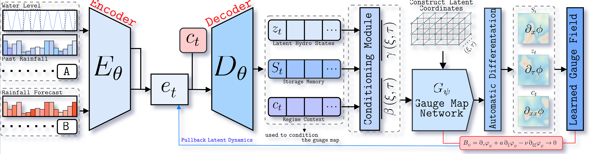
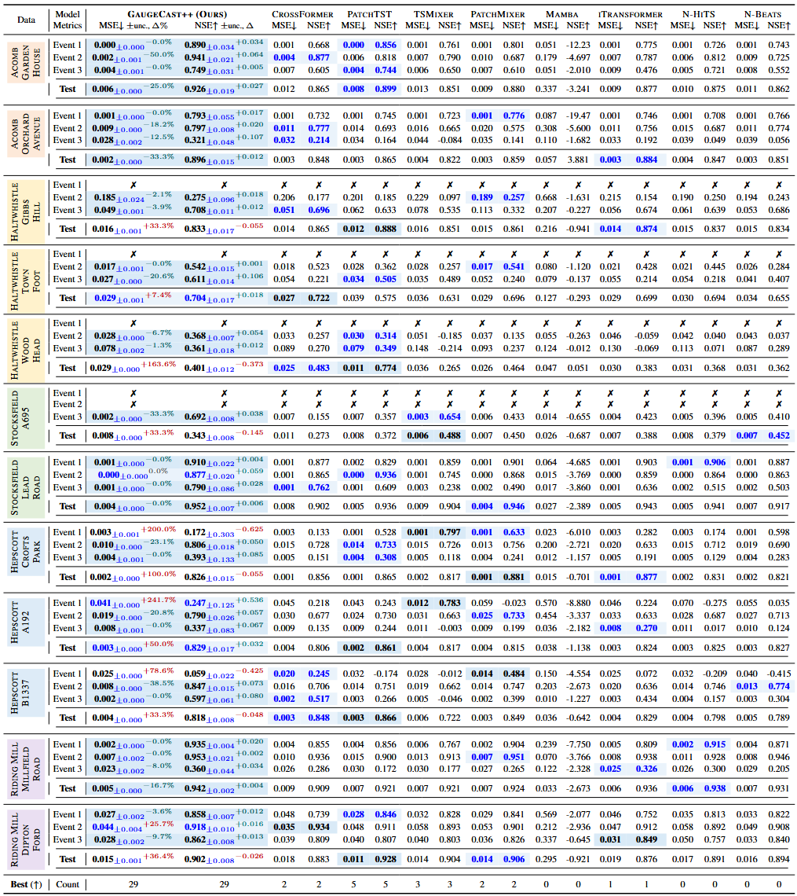

# GaugeCast++

[](https://neurips.cc/virtual/2026/loc/paris/poster/155744)
[]()
[](https://huggingface.co/datasets/Kukushkah/GaugeCast_EA_Dataset)
[](LICENSE)

## GaugeCast++: A Physics-Informed Latent Forecasting System for Localized Flood Prediction

**Adrian Kucia, Edward Rollason, Wai Lok Woo**  
**The Fortieth Annual Conference on Neural Information Processing Systems (NeurIPS 2026)**

> **Paper status:** Accepted at **NeurIPS 2026**. Poster available at the NeurIPS virtual site.

---

## Highlights

- **Physics-informed latent forecasting:** learns a sample-conditioned coordinate system that reduces residual transport before forecasting the latent dynamics.
- **Peak-aware temporal consistency:** explicitly regularizes flood-event phase and long-horizon compositional consistency.
- **Forcing-specific uncertainty diagnosis:** separates uncertainty attributable to future rainfall from deterministic hydrograph prediction.
- **Sparse-gauge operation:** designed for localized forecasting when dense hydrodynamic observations are unavailable.
- **Real-world evaluation:** evaluated across multiple UK Environment Agency river-gauge catchments with 15-minute observations and an 8-hour forecast horizon.

---

## Method Overview

GaugeCast++ combines three complementary mechanisms for reliable sparse-gauge flood forecasting.

### 1. Gauge-Conditioned Pullback Dynamics

<p align="center">
  
</p>

GaugeCast++ does not evolve flood dynamics directly in the original observation coordinates. Historical water level, rainfall, and future rainfall information are first encoded into latent hydrological states, storage memory, and regime context.

A **gauge-conditioned coordinate map** learns a sample-dependent transformation of the latent domain. Automatic differentiation provides the spatial and temporal derivatives of this learned coordinate field, defining the residual transport coefficient

---

### 2. Semigroup-Consistent Phase-Transport Learning

Long-horizon flood forecasts may preserve the approximate hydrograph amplitude while gradually drifting in time. In operational forecasting, this is particularly problematic because a correctly predicted flood magnitude can still provide a poor warning if the crest is predicted several hours too early or too late.

GaugeCast++ addresses this using **semigroup-consistent phase-transport learning**.

The model encourages direct long-horizon predictions to remain consistent with the evolution represented by shorter forecast horizons. A differentiable phase representation additionally tracks the temporal distribution of high-stage hydrograph mass.

This jointly regularizes:

- **trajectory-level consistency** across forecast horizons; and
- **event-phase consistency** of rising limbs, high-water periods, and flood crests.

The objective therefore targets horizon-dependent timing drift directly rather than treating temporal misalignment purely as pointwise prediction error.

---

### 3. Decoupled Inverse Rainfall Ambiguity

<p align="center">
  
</p>

Forecast errors can arise from deficiencies in the hydrological predictor, but they may also result from inaccurate or uncertain future rainfall forcing.

GaugeCast++ separates these sources through a **decoupled inverse rainfall ambiguity module**.

The trained deterministic predictor is frozen. Its hydrograph forecast, latent representation, rainfall information, and pullback-physics residual are then used as evidence for an inverse model which estimates a posterior distribution over unresolved future-rainfall discrepancy.

The inferred rainfall uncertainty is propagated through the rainfall-to-stage sensitivity of the frozen forecasting system to obtain a **forcing-specific ambiguity score**.

Importantly, this component is **diagnostic rather than corrective**. It does not modify the deterministic GaugeCast++ hydrograph. Instead, it identifies forecast windows in which elevated predictive risk can plausibly be attributed to uncertainty in future rainfall forcing.

---

## Main Results

GaugeCast++ is evaluated on six primary UK river-gauge catchments using observations sampled at **15-minute resolution**, with **32 historical steps (8 hours)** used to predict the following **32 steps (8 hours)**.

Across the primary benchmark, GaugeCast++ achieves the best MSE and NSE in **21 of 22 evaluated test/event comparisons**.

The largest gains are observed during challenging flood-event windows, including event-MSE reductions of up to **72.6% on Acomb Garden House** and **73.3% on Kielder** relative to the strongest competing baseline.

GaugeCast++ is compared against a broad set of modern forecasting architectures, including **Crossformer, PatchTST, TSMixer, PatchMixer, Mamba, iTransformer, N-HiTS, and N-BEATS**.

<p align="center">
  
</p>

---

## Ablation Study

Component-wise ablations demonstrate that the performance gains of GaugeCast++ arise from its structural modelling components rather than supervised sequence fitting alone.

Removing the **pullback PDE residual** or **storage dynamics** produces the largest degradation in event-scale performance. The learned gauge transformation, event-residual refinement, and semigroup/phase-consistency objectives provide additional improvements in predictive accuracy and flood-event behaviour.

<p align="center">
  
</p>

---

## Extended Evaluation

GaugeCast++ is additionally evaluated across UK monitoring sites with shorter observational records and heterogeneous hydrometeorological inputs.

The extended experiments include combinations of **river level, rainfall, soil volumetric water content, soil temperature, and forecast-side rainfall forcing**, providing a broader evaluation beyond the six primary benchmark catchments.

<details>
<summary><b>View extended catchment benchmark</b></summary>

<br>

<p align="center">
  
</p>

</details>

---

## Getting Started

### Installation

Clone the repository:

```bash
git clone https://github.com/Kukuszka/GaugeCast.git
cd GaugeCast
```

Install the required Python packages:

```bash
python -m pip install -r requirements.txt
```

Alternatively, create the provided Conda environment:

```bash
conda env create -f environment.yml
conda activate gaugecast
```

---

### Data

The GaugeCast++ benchmark is constructed from UK river-level and hydrometeorological monitoring records, including observations obtained from the **Environment Agency Hydrology Data Explorer**.

The processed dataset associated with this repository is hosted on the **Hugging Face Hub**:

[**GaugeCast EA Dataset**](https://huggingface.co/datasets/Kukushkah/GaugeCast_EA_Dataset)

Install the Hugging Face CLI:

```bash
python -m pip install huggingface_hub
```

Download the dataset:

```bash
hf download Kukushkah/GaugeCast_EA_Dataset \
  --repo-type dataset \
  --local-dir data/GaugeCast_EA_Dataset
```

The downloaded files will be stored under:

```text
data/GaugeCast_EA_Dataset/
```

The repository's `data/` directory is ignored by Git, so downloaded datasets remain local and are not committed to the repository.

Please consult the [GaugeCast EA Dataset page](https://huggingface.co/datasets/Kukushkah/GaugeCast_EA_Dataset) for dataset descriptions, source attribution, preprocessing information, and applicable data-licensing conditions.

---

## Citation

If you use GaugeCast++ or the associated dataset in your research, please cite:

```bibtex
@inproceedings{kucia2026gaugecast,
  title     = {GaugeCast++: A Physics-Informed Latent Forecasting System for Localized Flood Prediction},
  author    = {Kucia, Adrian and Rollason, Edward and Woo, Wai Lok},
  booktitle = {The Fortieth Annual Conference on Neural Information Processing Systems},
  year      = {2026}
}
```

The repository also includes [`CITATION.cff`](CITATION.cff) for GitHub-native citation support.

---

## Acknowledgements

This project is funded by **DEFRA (NUM015)** as part of the **£200 million Flood and Coastal Innovation Programmes**, managed by the Environment Agency.

The programmes support innovation in flood and coastal resilience and adaptation to a changing climate.

---

## License

The source code in this repository is released under the [MIT License](LICENSE).

Dataset files may be subject to separate licensing and attribution requirements. Please consult the associated dataset page and the original data providers for applicable terms.

---

## Contact

For questions regarding GaugeCast++, the dataset, or the experiments, please open a GitHub issue.

For research-related enquiries:

| Name | Role | Institution | Email |
|---|---|---|---|
| Adrian Kucia | Lead Author | School of Computer Science, Northumbria University, UK | adrian.kucia@northumbria.ac.uk |
| Adrian Kucia | Personal | — | adriankucia2000@gmail.com |
| Wai Lok Woo | Corresponding Author | School of Computer Science, Northumbria University, UK | wailok.woo@northumbria.ac.uk |
