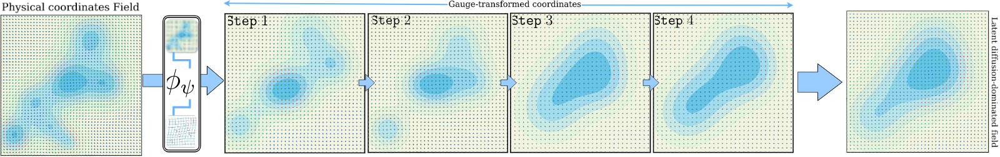

# GaugeCast++: A Physics-Informed Latent Forecasting System for Localized Flood Prediction

[]()
[]()
[](LICENSE)

Official PyTorch implementation of:

**GaugeCast++: A Physics-Informed Latent Forecasting System for Localized Flood Prediction**  
Adrian Kucia, Edward Rollason, Wai Lok Woo  
**NeurIPS 2026**

GaugeCast++ is a physics-informed sparse-gauge forecasting framework for localized flood prediction. It combines a gauge-conditioned pullback operator, semigroup-consistent phase-transport learning, and decoupled inverse rainfall ambiguity modelling.

<p align="center">
  
</p>

> **Paper status:** NeurIPS 2026 paper link and publication details will be added when available.

## News

- **2026-11-15:** Initial public repository scaffold and project README created.

## Overview

GaugeCast++ targets localized flood forecasting from sparse stream-gauge observations. The framework structures forecasting around three components:

### Contribution 1 – Gauge-Conditioned Pullback

GaugeCast++ learns a diffeomorphic coordinate transformation that suppresses residual transport and produces a better-conditioned latent forecasting problem.

<p align="center">
  
</p>

### Contribution 2 – Semigroup-Consistent Phase Transport

The model enforces consistency between direct long-horizon forecasts and composed shorter-horizon evolution while explicitly penalizing flood-event phase drift.

<p align="center">
  
</p>

### Contribution 3 – Inverse Rainfall Ambiguity

A separate inverse module estimates forcing-side uncertainty caused by imperfect future rainfall without modifying the deterministic hydrograph forecast.

<p align="center">
  
</p>

## Installation

Create an environment and install the dependencies:

```bash
conda env create -f environment.yml
conda activate gaugecast
```

Or install with pip:

```bash
python -m pip install -r requirements.txt
```

## Data

Place input datasets in `data/`. The repository does not currently include datasets; see [`data/README.md`](data/README.md) for notes. Data files are excluded from version control by `.gitignore`.

## Quick Start

The repository currently contains a project scaffold. Training, evaluation, and prediction entry points are placeholders and will raise `NotImplementedError` until their workflows are implemented. The example below shows the intended interface, not a runnable command yet:

```bash
python train.py --config configs/acomb_garden_house.yaml
```

## Training

Training functionality is not implemented yet. The `train.py` entry point and `scripts/train_all.sh` are placeholders. Site-specific configuration files are in `configs/`.

## Evaluation

Evaluation functionality is not implemented yet. The `evaluate.py` entry point is a placeholder.

## Reproducing Paper Results

The scripts in `scripts/` are scaffold placeholders. Commands to reproduce the paper's tables, ablations, and uncertainty analysis will be added with the training and evaluation implementation:

- `scripts/reproduce_table1.sh`
- `scripts/reproduce_table3.sh`
- `scripts/reproduce_ablation.sh`
- `scripts/reproduce_uncertainty.sh`

## Results

No results are included yet. Generated outputs can be stored in `results/`; see [`results/README.md`](results/README.md).

## Pretrained Models

No pretrained models are available in this repository yet.

## Citation

If you use this project, please cite the paper when its final publication details are available:

```bibtex
@inproceedings{kucia2026gaugecast,
  title     = {GaugeCast++: A Physics-Informed Latent Forecasting System for Localized Flood Prediction},
  author    = {Kucia, Adrian and Rollason, Edward and Woo, Wai Lok},
  booktitle = {The Fortieth Annual Conference on Neural Information Processing Systems},
  year      = {2026}
}
```

The repository also includes [`CITATION.cff`](CITATION.cff).

## Acknowledgements

Acknowledgements will be added when the paper and project details are finalized.

## Contact

For questions about this repository, open a GitHub issue. Contact details will be added when available.
